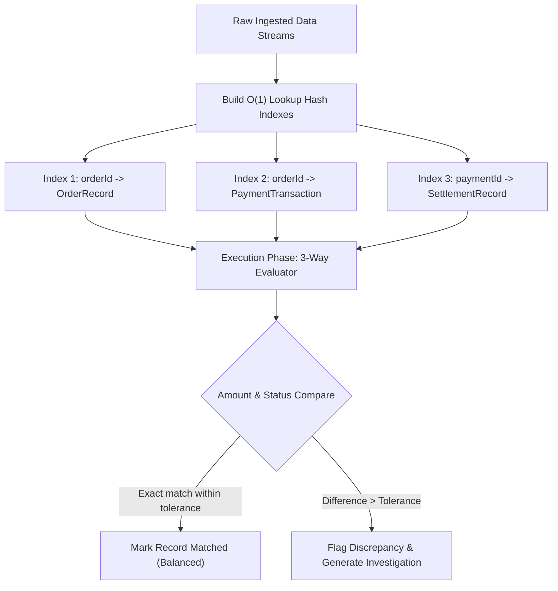
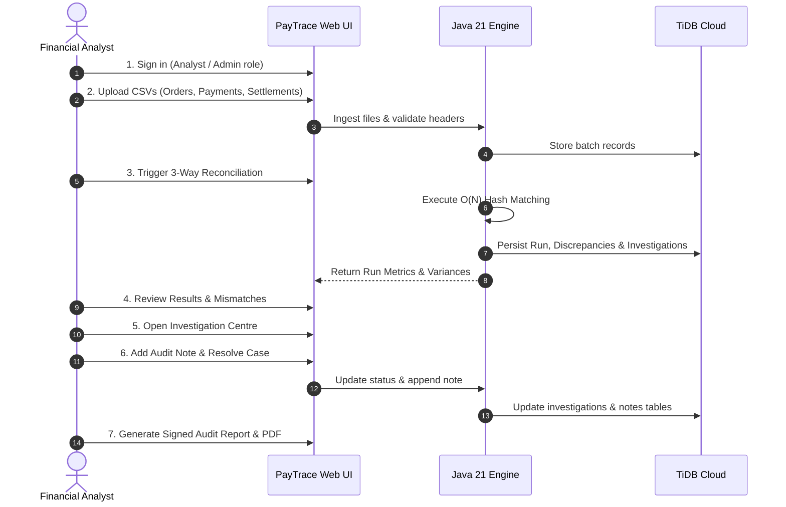

# PayTrace — Payment Discrepancy Detection & Reconciliation System

> **A Financial Operations & 3-Way Algorithmic Transaction Reconciliation Platform**  
> Built as an Academic Java OOP & Modern Fintech Web Application.

[](https://spring.io/projects/spring-boot)
[](https://openjdk.org/)
[](https://react.dev/)
[](https://www.typescriptlang.org/)
[](https://tidbcloud.com/)
[](https://frontend-woad-one-82.vercel.app)
[](https://paytrace-lj2l.onrender.com)

---

## 🌐 Live Cloud Deployments

* **Production Frontend (Vercel):** [https://frontend-woad-one-82.vercel.app](https://frontend-woad-one-82.vercel.app)
* **Production Backend (Render):** [https://paytrace-lj2l.onrender.com](https://paytrace-lj2l.onrender.com)
* **Backend Health Check:** [https://paytrace-lj2l.onrender.com/api/health](https://paytrace-lj2l.onrender.com/api/health)
* **Distributed Cloud Database:** TiDB Cloud Distributed MySQL Cluster (`paytrace_db`)

---

## 1. Executive Summary (Non-Technical Overview)

### The Business Challenge
Modern digital commerce platforms accept payments through payment gateways (Stripe, Adyen, Razorpay) and receive bank deposits from acquiring banks (JPMorgan Chase, Citi, HDFC). In high-volume operations, **three systems record each transaction independently**:
1. **Order Management System (OMS):** What the customer placed in their cart and purchased.
2. **Payment Gateway Captured Logs:** What the gateway authorized, deducted processing fees for, and captured.
3. **Acquiring Bank Settlement Statements:** What was settled and deposited into the merchant's bank account.

Discrepancies happen constantly:
* **Amount Shortfalls:** Gateway fees or currency conversions differ from the quoted order.
* **Missing Payments & Ghost Orders:** Customers are double-charged, or orders are marked completed without captured funds.
* **Settlement Delays:** Funds remain floating in banking queues, creating cash-flow black holes.
* **Double Deductions:** Multiple gateway capture attempts recorded against a single order.

Finance teams traditionally spend days cross-referencing messy spreadsheets. **PayTrace** automates this entire audit pipeline in real time.

### The PayTrace Solution
PayTrace is an automated, algorithmic 3-way financial reconciliation engine that:
* Ingests thousands of transaction records across all three sources.
* Compares orders, gateway captures, and bank deposits in milliseconds using an $O(N)$ matching algorithm.
* Flags and categorizes every mismatch down to the exact cent or rupee with clear mathematical explanations.
* Provides a **Financial Investigation Centre** where analysts review cases, record audit notes, and formally resolve discrepancies.
* Produces an official **Executive Audit Certificate & PDF Balance Sheet** ready for compliance officers and external auditors.
* Operates under a strict **Zero-Fund-Custody Architecture** (auditing and data matching only, never holding or moving customer funds).

---

## 2. Core Team Ownership & Academic OOP Assignment

The project is structured with modular Java OOP package separation:

| Team Member | Workspace Package Folder | Git Branch | Core Responsibility |
| :--- | :--- | :--- | :--- |
| **Thurika G** | [`com.paytrace.thurika_models`](backend/src/main/java/com/paytrace/thurika_models/) | `feature/java-data-models` | **Domain Entities & OOP Hierarchy:** Built the abstract base class `BaseFinancialRecord`, concrete subclasses (`OrderRecord`, `PaymentTransaction`, `SettlementRecord`), and `DiscrepancyType` taxonomy. |
| **Sujith E** | [`com.paytrace.sujith_engine`](backend/src/main/java/com/paytrace/sujith_engine/) | `feature/reconciliation-engine` | **3-Way Reconciliation Algorithm:** Designed the $O(N)$ multi-index hash matching engine, `BigDecimal` tolerance matching ($\pm0.05$), variance math, and summary metrics. |
| **Tharun J** | [`com.paytrace.tharun_ingestion`](backend/src/main/java/com/paytrace/tharun_ingestion/) | `feature/csv-import` | **Data Ingestion & Validation Pipeline:** Developed the streaming OpenCSV reader, row-level schema validation, and non-blocking error collection. |
| **Mithunasri J** | [`com.paytrace.mithunasri_workflow`](backend/src/main/java/com/paytrace/mithunasri_workflow/) | `feature/investigation-testing` | **Workflow State Machine & Testing:** Built `InvestigationCase` state machine (`OPEN` $\to$ `UNDER_REVIEW` $\to$ `RESOLVED`), audit trail logging, and JUnit 5 test suites. |

---

## 3. Technical Architecture & Tech Stack

```
┌─────────────────────────────────────────────────────────────────────────┐
│                           PAYTRACE ARCHITECTURE                         │
└─────────────────────────────────────────────────────────────────────────┘
  [ CLIENT LAYER ]
  React 18 • TypeScript • Tailwind CSS • Vite 6 • Lucide Icons • Recharts
  Web Audio API (Synthesized financial oscillators: coin chimes, rubber stamps)
                                    │
                                    ▼ (HTTPS / JSON REST API + JWT)
  [ APPLICATION / ENGINE LAYER ]
  Spring Boot 3.4.x (Java 21 LTS) on Render Cloud
  ├── Tharun:   Streaming Ingestion (OpenCSV) & Multipart File Validation
  ├── Thurika:  Polymorphic Domain Model Hierarchy (BaseFinancialRecord)
  ├── Sujith:   3-Way Algorithmic Matching Engine (O(N) Hash Indexing)
  └── Mithuna:  Investigation Workflow State Machine & Audit History
                                    │
                                    ▼ (HikariCP Connection Pool + SSL)
  [ CLOUD DATABASE LAYER ]
  TiDB Cloud (Distributed Serverless MySQL 8.0 Protocol)
  Tables: orders, payments, settlements, reconciliation_runs, discrepancies,
          investigations, investigation_notes
```

### Complete Technology Stack:
* **Frontend:** React 18, TypeScript, Tailwind CSS ("Midnight Luxe" palette: Deep Navy `#0B1120`, Gold `#D6B66C`, Emerald `#26966B`, Crimson `#D95C5C`), Lucide React icons, Recharts data visualization.
* **Backend:** Spring Boot 3.4.x, Java 21 LTS, Spring Web, Spring Security, JUnit 5.
* **Database:** TiDB Cloud Distributed MySQL (using `DECIMAL(15,2)` for financial fields to eliminate IEEE 754 floating-point rounding errors).
* **Audio Feedback:** HTML5 Web Audio API synthesizer for interactive audio feedback (coin chimes, resolution stamps).
* **Dual Operation Modes:**
  * **Live Mode:** Real-time persistence to Render backend and TiDB Cloud.
  * **Demo Mode:** Fully functional client-side mock engine in browser memory for zero-dependency presentations and offline evaluation.

---

## 4. The 3-Way Reconciliation Algorithm

The engine achieves **$O(N)$ linear time complexity** (avoiding costly $O(N^3)$ nested loops):



### Supported Discrepancy Types:
1. **`AMOUNT_MISMATCH`:** Order amount differs from captured amount (e.g., Order ₹250.00 vs. Gateway captured ₹230.00).
2. **`MISSING_PAYMENT`:** Order exists in OMS, but no payment gateway log was captured.
3. **`MISSING_ORDER`:** Gateway captured payment, but no matching order exists in OMS.
4. **`MISSING_SETTLEMENT`:** Payment was captured, but acquiring bank has not deposited the funds.
5. **`UNMATCHED_SETTLEMENT`:** Bank deposited a settlement, but no gateway transaction matches.
6. **`DUPLICATE_TRANSACTION`:** Multiple gateway charges detected against a single order ID.

---

## 5. End-to-End Application Workflow



### Complete Page Inventory:
1. **Landing Page (`/`):** 3D perspective credit cards, interactive golden balance coin, before/after reconciliation interactive slider.
2. **Sign In (`/login`):** 3D flippable card with realistic EMV chip, quick demo sign-in for Lead Analyst (`analyst@paytrace.dev`) and System Admin (`admin@paytrace.dev`).
3. **Dashboard (`/dashboard`):** 4 real-time KPI metrics, 7-day velocity chart, discrepancy archetype breakdown, and recent flagged items.
4. **Import Data (`/import`):** Tri-fold drag-and-drop zone with pre-loaded downloadable CSV templates and 1-click synthetic batch generator.
5. **Reconciliation Workspace (`/reconcile`):** Animated 3-stream ingestion diagram, engine progress stepper, and live monospace execution log.
6. **Results & Mismatches (`/results`):** Side-by-side comparative table showing OMS, Gateway, and Bank settlement columns with highlighted variance cells.
7. **Investigation Centre (`/investigations`):** Queue of open variances, full financial case file dossier, resolution categories (`BANK_FEE_VARIANCE`, `TIMING_DIFFERENCE`, `DATA_CORRECTION`), and timeline of analyst notes.
8. **Reports & Audit (`/reports`):** Official "Certificate of Reconciliation Balance", Tri-Fold Financial Position Summary table, analyst sign-off blocks, and `@media print` optimized layout for PDF export.
9. **Batch History (`/history`):** Historical run ledger with "View Results" selector and immutable audit trail log.
10. **System Settings (`/settings`):** Real-time cloud telemetry status, mode switch toggle (Live Cloud vs. Demo Mocks), audio volume sliders, and sound effects test station.

---

## 6. Cloud Database Schema (TiDB Cloud)

The database schema is partitioned into 7 transactional tables:

| Table Name | Primary Key | Description |
| :--- | :--- | :--- |
| `orders` | `order_id` | OMS order details (customer, timestamp, decimal amount, currency, status). |
| `payments` | `payment_id` | Gateway logs (order link, captured amount, processor fee, gateway provider). |
| `settlements` | `settlement_id` | Bank records (payment link, gross amount, net payout, fee, bank reference). |
| `reconciliation_runs` | `run_id` | Executed reconciliation batches, match rates, total order and settled values. |
| `discrepancies` | `id` | Flagged variances with severity, expected vs. actual amounts, and explanations. |
| `investigations` | `id` | Investigation dossiers linked to discrepancies with status, resolution category, and notes. |
| `investigation_notes` | `id` | Timestamped, immutable analyst audit commentary for compliance tracking. |

---

## 7. Local Setup & Testing

### Prerequisites
* **Node.js** v18+ or v20+
* **Java JDK 21 LTS**
* **Apache Maven 3.9+**

### Frontend Setup
```bash
cd frontend
npm install
npm run dev
```
Open [http://localhost:5173](http://localhost:5173).

### Backend Setup
```bash
cd backend
mvn spring-boot:run
```
The server runs on [http://localhost:8080](http://localhost:8080).

### Running Automated Tests
```bash
cd backend
mvn test
```
All 15 regression and empty-database test suites execute and validate the matching engine.

---

## 8. Team Acknowledgments

Built with 🩷 by **Thurika G**, **Sujith E**, **Tharun J**, and **Mithunasri J**  
*Academic Project • Payment Discrepancy Detection & Financial Reconciliation System*
